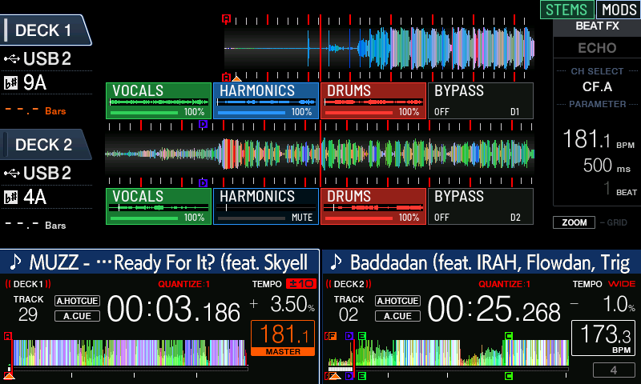
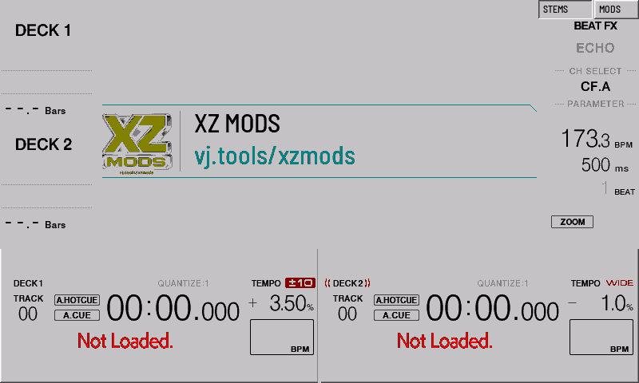

# XZ Mods user guide

For XDJ-XZ firmware 1.26 and Windows build 0.1.6. This download
includes the split rows, themes and physical pad fixes shown below. Rebuild
your existing USB loader to get the update. Back up and remove its existing
`autoexec.bin` before using the builder. See [build instructions](../BUILDING.md)
to build source.

## Prepare your USB

1. Back up your Rekordbox USB. Start with a few tracks and a spare FAT/FAT32 USB.
2. Extract the supplied XZ Mods 0.1.6 ZIP.
   Extract it and keep `XZ Mods.exe` beside its `resources` folder. Windows needs
   WebView2. VJ.Tools and a separate Python installation are not required.
3. Plug in the USB. In **Prepare USB**, click **Choose USB and prepare loader**
   and select the USB drive root. The app downloads and verifies the official
   firmware and required boot support, then builds and checks `autoexec.bin`.
   First setup downloads about 320 MB; verified files are cached locally.
   The USB must be FAT/FAT32. Existing music and loader files are not overwritten.
   The public download contains no firmware, boot support or personal boot image.
4. Prepare stems with [OverCue](https://overcue.gg/). This is the recommended
   path. OverCue Desktop separates your tracks and writes a `CDJMODS` folder on
   your Rekordbox USB. Keep the matching `Contents` and `CDJMODS` folders on the
   same USB. Open **Prepare stems > Check OverCue track** and choose the original
   track inside `Contents`. This reads the source and all prepared pages without
   changing them. Both new lossless FLAC pages and legacy zlib pages are supported,
   including OverCue Desktop's **Repack existing** output. Update the USB loader
   with this local build before loading FLAC-prepared tracks on the XZ.
5. Or use the beta stem builder in **Prepare stems > Build stems in XZ Mods**.
   It writes the same [open OverCue format](https://github.com/OverCue-gg/overcue-stems-format)
   under `CDJMODS` and never replaces stems OverCue made. Export the track with
   Rekordbox first. It must be a 44.1 kHz stereo WAV or FLAC file in the USB's
   `Contents` folder. Choose that track, choose an engine, then click
   **Prepare stems**. Separation runs on the CPU, one track at a time, with
   bounded model windows and disk-backed audio buffers. Generate and Import write
   lossless FLAC pages. Temporary disk space replaces full-track RAM allocations;
   the app checks space before processing. To use stems you
   already have, open **Use stems you already have**, set up the engine and
   import aligned harmonics and vocals for the same track. The beta has not been
   qualified on hardware. Check each track on the player before you use it in a set.

Start the XZ with the prepared mod USB using the boot procedure for your image.
Load the matching original through the native browser. Wait for stem loading to
finish, listen quietly to the original mix, then test each stem. A successful
file check does not establish audible alignment or playback performance.

## Use the split rows in current source

Each deck has four controls: **Vocals, Harmonics, Drums, Bypass**.

- Tap a stem to mute or restore it.
- Drag horizontally on a stem button to adjust its volume percentage. Raising
  a muted stem restores it.
- Tap Bypass to switch that deck to its original mix.
- Tap the top STEMS button to hide or show the rows. Visibility does not disable
  stem audio or the physical pad assignments.

This is a real capture of the runtime included in preview 0.1.4.
Earlier preview 0.1.2 has the selected-deck strip.

## Assign physical stem pads

Open **MODS → Controls**. Choose a stem pad page and the **A–D** or **E–H** bank,
then select that physical pad page on the deck. Keep pad feedback enabled.

| Position in assigned bank | Control | Current-source physical color |
| --- | --- | --- |
| First | Vocals | Green |
| Second | Harmonics | Blue |
| Third | Drums | Red |
| Fourth | Bypass | White when enabled |

Active stems use normal brightness; muted or zero-volume stems are dim.
The inactive bank retains native hot cues. Deck assignments are independent.
Physical colors do not change with the screen theme. Brightness and clean
audio were confirmed on hardware. The tester also confirmed the latest pure
green, blue and red hues.

## Change appearance in current source

Open **MODS → Appearance**, choose a style and close MODS to see the native
player. Styles are Original, White, Cyberpunk, Neon, Mocha, Aurora, Sandstone,
Game Boy, Super Nintendo, Windows 95, Game Boy Color, Aqua / iTunes,
Game Boy DMG and Liquid Glass. Each of the last seven has **Light** and **Dark**
buttons, for 21 appearances total. The original green Game Boy remains available;
Game Boy DMG is the separate gray-shell design. The pixel font supports lowercase
and renders Latin-1 accents as base letters.
These additions are unreleased and have been reviewed in the software renderer.
They have not yet been loaded on the player.
Preview 0.1.2 includes the seven earlier styles.

This RAM-trial capture shows gray panels, dark text and the XZ Mods loading
banner with no tracks loaded. The native adapter covers artwork, text,
waveforms, markers and dialogs; full screen-family verification is ongoing.
The 0.1.4 loader automatically applies the original loading artwork to a validated
copy of the device GUI in RAM. The public package contains only the replacement
artwork, not the manufacturer GUI pack.

The streamlined menu has Controls, Appearance, VJ.Tools and Advanced. VJ.Tools is
optional; its corner button appears only when the connection setting is enabled
and the network connection is live. Exit VJ returns to native playback.

## Return to stock and recover

Power off, remove the mod boot USB and start normally. Rebooting with that USB
present can load the mod again. RAM-trial settings reset on reboot; normal USB
builds can save settings to the USB.

If audio becomes corrupted during testing, stop playback and fully reboot.
Reload the same track and check the original mix before continuing. The runtime
runs in RAM, but experimental software can still crash or disrupt playback.
The user confirmed USB preparation and XDJ-XZ cold boot with 0.1.5. Extended
two-deck, loop, focus and experimental-control qualification remains in progress.

## Related projects

- [CDJ3K-Mods](https://cdj3k-mods.com/) and its
  [source repository](https://github.com/nsaintot/cdj3k-mods): CDJ-3000 mods.
- [OverCue](https://overcue.gg/): CDJ-3000 mods and desktop stem preparation.
  XZ Mods reads supported prepared audio; the OverCue CDJ installer is not an XZ installer.
- [XDJ-RX3 Toolkit](https://github.com/Tratosca/rx3-toolkit): the RX3 project,
  not a mod for the original XDJ-RX.
- [XDJ-AZ Mods](https://github.com/Kyle-Hosman/xdj-az-mods): AZ mod loader and tools.

These projects have separate compatibility and installation requirements.

## Update a USB that already has a loader

1. Open **USB loader > Choose USB to update** and select the USB root.
2. Check the selected folder and existing loader details.
3. Select **Back up and update loader**. The app verifies the new image before
   replacing `autoexec.bin` and keeps the previous bytes under
   `VJ.Tools/XZ-Mods-updates`.
4. Eject the USB safely after completion. Music, Rekordbox data and saved
   preferences remain in place.

If you selected a prepared folder, copy its resulting loader to the USB root.
Use **Restore a previous loader** to restore a checked backup. A changed file
or reconnected volume requires a fresh inspection. An update/restore does not
start the XZ or install firmware over a network.

## Edit saved settings

Open **USB settings**, choose the partition containing `VJ.Tools/XZ-Mods.cfg`,
change the fields, and click **Save settings to USB**. The app reads the file
back after saving. Select a pad row in Stem shortcuts to assign A-D or E-H.
Beat Jump shows backward/forward pairs and both beat/bar units. New options
require the matching updated loader. Unknown settings formats are preserved
and cannot be overwritten by this editor.

If the loader uses a separate settings partition, choose that partition rather
than the music partition. The current controller trial uses USB1's first
partition because the second reported a FAT error and is mounted read-only.

## Controller controls

**Close** is at the top right, where MODS opens. **Controls** has separate
**Stem Shortcuts** and **Beat Jump** views. Both show eight pads. Stem shortcuts
assign one four-pad row; Beat Jump assigns four backward/forward pairs on each
page. Page 2 defaults to 16/32/64/128 beats, or 4/8/16/32 bars. Shift + Beat Jump
selects page 2 by default, with alternate warm red/orange pad lights.

## Prepare stems

Open Prepare stems. XZ Mods finds the connected Rekordbox USB and lists every
track on it. The bar at the top shows the USB, how many tracks are ready, the
free space and one line that says what your selection will cost. To use
another USB, open the drive menu. Its last two entries are Choose a folder...
and Look for USBs again. If no USB is found, Connect a USB walks you through
finding or choosing one.

Each track shows a status you can read at a glance. Missing has no stems yet.
Ready has stems on the USB. Not yet means the format (AIFF or AAC) is not
supported yet. No audio file means the track file is not on the USB; export it
from Rekordbox again. MP3, WAV and FLAC tracks all prepare the same way. The
Format column shows which one a track is, and the Size column shows its
estimated size on the USB. Use the tabs to show only Missing, Ready or Can't
prepare tracks, and the search box to find a title or artist.

### Set up the stem engine once

The first time, the button in the bar reads Set up stem engine. It opens a
short setup: XZ Mods checks this computer, you choose a quality, it downloads
what it needs once, then it tests on 30 seconds of your first selected track.
Balanced is recommended on computers with a graphics card or Apple silicon,
Fast on computers without one. Every downloaded file is checked against its
fingerprint. If setup cannot finish, it names the reason and offers the one
fix, for example Use the processor when the graphics driver is too old. To
change quality later, choose Change next to the engine name.

### Select and prepare

Tick the tracks you want, or use the box at the top of the table to select
every Missing track in view. A batch holds up to 100 tracks. The estimate line
shows the total size and the space left after, for example 12 tracks selected
· about 4.9 GB · 38.0 GB free after. It turns amber when space gets tight and
red when the selection does not fit. In that case the button reads Prepare N
that fit and prepares the selected tracks in order until the next one would not
fit. Tracks it leaves out stay selected.

Choose Prepare N tracks. Rows change in place: Queued, then Preparing with a
percentage and the current step, then Ready. The bar shows which track is
running and about how long is left. The first time on a new computer it says
Timing this computer until it has a measurement. Cancel stops within a
second. Finished tracks are kept; the one in progress is discarded.

When the batch ends, the bar says what happened and offers the next step:
Retry N failed, Prepare N remaining after a cancel, Continue after the USB was
unplugged (nothing is left half-written), or Choose fewer tracks when the USB
filled up. Prepared tracks leave the selection.

### Track details

Click a row to open its details. Ready tracks show who prepared them and
offer Verify, which reads every audio page without changing the USB, plus
Import stems to replace and Prepare again. Prepare again asks first and keeps
the current stems until the new ones pass their check. A track that fails
Verify shows Damaged and can be selected to prepare again.

## Import stems made elsewhere

Choose Import stems in the toolbar, or Import stems made elsewhere in a
track's details. Drop stem files or a ZIP into the window, or choose files.
Suno, Demucs, UVR and other WAV, FLAC, MP3 or AIFF sets work. From the
toolbar, pick which track the stems are for.

Next checks the files. XZ Mods places each file on Vocals, Drums or Harmonics
by its name and lines the stems up with the track on your USB, shifting and
levelling them automatically. Change any Goes to choice you disagree with. If
a file's name says nothing, choose its place; Leave out skips it. If the stems
do not line up, or come from a different song, the window says so and offers
other files or another track.

A vocals and instrumental pair needs the stem engine to pull the drums out of
the instrumental, so the XZ gets a separate Drums button. If the engine is not
set up yet, the import offers Set up stem engine and continues where you left
it afterwards.

Write stems to USB writes the seven stem mixes the XZ plays and checks them.
Your stem files and the track itself stay as they are. When stems replace
existing ones, the old stems stay until the new ones pass their check.

## Update the Windows app

Open App updates and choose Check for updates. When a signed update is available, review its new features and bug fixes, then choose Download and install update. Finish any USB or stem operation first. The Windows installer updates the app and reopens it.

For a portable copy, download the ZIP and extract it into a new folder. The in-app installer installs the standard Windows version. Updating the app does not replace the loader on a USB; use USB loader for that.

## Install the Mac utility

Download the Apple Silicon or Intel package for your Mac from the matching release.
macOS 14 or later is required. Open the DMG and copy XZ Mods to Applications.
These preview packages are ad-hoc signed and are not notarized. If macOS blocks
opening, use System Settings > Privacy & Security > Open Anyway for XZ Mods,
then confirm opening the app you downloaded from this repository.

Apple Silicon can generate stems with the approved models. Intel Macs can import
aligned stems, prepare or update a USB, edit settings, and use waveform and game
setup. App updates use signed architecture-specific bundles when available.

## New FLAC stem pages

The reader accepts OverCue's OVPGZ003 FLAC pages and existing OVPGZ001 zlib
pages. Generate and Import write FLAC and verify all seven playback mixes.
Keep Contents and CDJMODS together. Update an older USB loader through USB
loader > Back up and update loader before using the new FLAC pages on the XZ.

## Open games when wanted

Normal XZ Mods startup keeps the DJ screen open. Choose MODS > Extras > Games
for Beat Arcade, Wave Rider or installed Doom data. Beat Arcade and Wave Rider
never become a saved startup preference. Automatic opening is a local test
switch that the normal USB loader does not set.

Games setup can obtain Doom shareware, Chex Quest and Freedoom and verify copied
data. Choose your own licensed commercial IWAD for commercial Doom content.
MyHouse needs a native GZDoom engine that remains unavailable; downloading its
files does not qualify its engine or controller controls.
