# Button glyphs on the XZ screen: firmware spec

Generated by `python tools/xz_buttons.py firmware` from `GLYPHS` in `tools/xz_buttons.py`. Do not edit by hand.

For a later firmware pass: the XZ's own MODS screens can show the same glyph wherever they name a button, as the manual and the desktop app do. The display is 800 x 480, 32-bit colour. MODS text comes in two faces of the firmware font, Barlow Semi Condensed (`mods/ui/fonts`): `SH_SMALL` at 12 px and `SH_TEXT` at 20 px.

## How a glyph sits in a MODS line

- The glyph is the control without its printed text, on a rounded piece of the dark panel, followed 3 px later by the name below as ordinary MODS text in the line's own face. At these sizes no printed text on a cap or the panel is legible, so the shape and the lamp colour identify the control and the text names it.
- Beside `SH_SMALL` text the glyph is **14 px** tall (scale 0.4375 of the design below); beside `SH_TEXT` it is **22 px** tall (scale 0.6875). Centre it on the text's cap height.
- Scale every value below by that factor and round to whole pixels. Rings, outlines and pad edges stay at least 1 px; a lamp ring 2 px at 22 px. Leave out the light-from-above highlight and the glow at 14 px; at 22 px the glow is one pixel of the lamp colour at half strength round the lit shape.
- A lit lamp is drawn in its lit colour, a lamp that is off in its off colour. Use the state the screen describes (for example SYNC lit when the text says SYNC is on); with no state to show, draw it lit.
- The PNGs are the browser render of the same drawing at the XZ's size, label included: the target to match.
- The design is 32 units tall. Coordinates are x, y from the glyph's top left; the panel piece is the whole glyph box, corner radius 5, fill `#151617`, edge `#34373b`. Colours not listed are the cap gradient's base `#0b0b0c`.

## PLAY/PAUSE (`play-pause`)

Where: each deck, bottom left; PLAY/PAUSE printed above. Text after it: `PLAY/PAUSE`.

**Lit**:  

| Part | Design units | Colour | Note |
|---|---|---|---|
| ring | centre 18.0, 16.0; r 13.5; stroke 2.8 | `#27e35a` |  |
| circle | centre 18.0, 16.0; r 10.4 | `#0b0b0c` | cap |
| symbol play-pause | 14.9, 13.8; 8.7 x 4.4 | `#f1f2f0` |  |

**Lamp off**:  

| Part | Design units | Colour | Note |
|---|---|---|---|
| ring | centre 18.0, 16.0; r 13.5; stroke 2.8 | `#3a3d41` |  |
| circle | centre 18.0, 16.0; r 10.4 | `#0b0b0c` | cap |
| symbol play-pause | 14.9, 13.8; 8.7 x 4.4 | `#f1f2f0` |  |

## CUE (`cue`)

Where: each deck, above PLAY/PAUSE. Text after it: `CUE`.

**Lit**:  

| Part | Design units | Colour | Note |
|---|---|---|---|
| ring | centre 18.0, 16.0; r 13.5; stroke 2.8 | `#ff5f14` |  |
| circle | centre 18.0, 16.0; r 10.4 | `#0b0b0c` | cap |

**Lamp off**:  

| Part | Design units | Colour | Note |
|---|---|---|---|
| ring | centre 18.0, 16.0; r 13.5; stroke 2.8 | `#3a3d41` |  |
| circle | centre 18.0, 16.0; r 10.4 | `#0b0b0c` | cap |

## SYNC (`sync`)

Where: each deck, BEAT SYNC pair right of the jog; hold for INST. DOUBLES. Text after it: `SYNC`.

**Lit**:  

| Part | Design units | Colour | Note |
|---|---|---|---|
| ring | centre 16.0, 16.0; r 11.5; stroke 2.4 | `#ececea` |  |
| circle | centre 16.0, 16.0; r 8.8 | `#0b0b0c` | cap |

**Lamp off**:  

| Part | Design units | Colour | Note |
|---|---|---|---|
| ring | centre 16.0, 16.0; r 11.5; stroke 2.4 | `#3a3d41` |  |
| circle | centre 16.0, 16.0; r 8.8 | `#0b0b0c` | cap |

## MASTER (`master`)

Where: each deck, BEAT SYNC pair, right of SYNC. Text after it: `MASTER`.

**Lit**:  

| Part | Design units | Colour | Note |
|---|---|---|---|
| ring | centre 16.0, 16.0; r 11.5; stroke 2.4 | `#ff6a10` |  |
| circle | centre 16.0, 16.0; r 8.8 | `#3b1d0c` | cap |

**Lamp off**:  

| Part | Design units | Colour | Note |
|---|---|---|---|
| ring | centre 16.0, 16.0; r 11.5; stroke 2.4 | `#3a3d41` |  |
| circle | centre 16.0, 16.0; r 8.8 | `#0b0b0c` | cap |

## MASTER TEMPO (`master-tempo`)

Where: each deck, above the TEMPO slider; MASTER TEMPO printed above. Text after it: `MASTER TEMPO`.

**Lit**:  

| Part | Design units | Colour | Note |
|---|---|---|---|
| circle | centre 12.8, 16.0; r 7.5 | `#0b0b0c` | cap |
| circle | centre 12.8, 16.0; r 2.7 | `#ff2424` | LED |

**Lamp off**:  

| Part | Design units | Colour | Note |
|---|---|---|---|
| circle | centre 12.8, 16.0; r 7.5 | `#0b0b0c` | cap |
| circle | centre 12.8, 16.0; r 2.7 | `#3e1515` | LED |

## TEMPO ±6/±10/±16/WIDE (`tempo-range`)

Where: each deck, top of the TEMPO slider column. Text after it: `TEMPO ±6/±10/±16/WIDE`.

**No lamp**:  

| Part | Design units | Colour | Note |
|---|---|---|---|
| circle | centre 12.8, 16.0; r 7.5 | `#0b0b0c` | cap |

## TEMPO RESET (`tempo-reset`)

Where: each deck, left of the TEMPO slider; its lamp is beside the slider. Text after it: `TEMPO RESET`.

**Lit**:  

| Part | Design units | Colour | Note |
|---|---|---|---|
| circle | centre 12.8, 16.0; r 7.5 | `#0b0b0c` | cap |
| rect | 24.6, 14.4; 6.0 x 3.2 | `#d6f53c` | lamp |

**Lamp off**:  

| Part | Design units | Colour | Note |
|---|---|---|---|
| circle | centre 12.8, 16.0; r 7.5 | `#0b0b0c` | cap |
| rect | 24.6, 14.4; 6.0 x 3.2 | `#2f3612` | lamp |

## IN/CUE (`in-cue`)

Where: each deck, top row; SHIFT: IN ADJUST. Text after it: `IN/CUE`.

**Lit**:  

| Part | Design units | Colour | Note |
|---|---|---|---|
| circle | centre 14.8, 16.0; r 9.5 | `#ff9a1c` | whole cap lit |

**Lamp off**:  

| Part | Design units | Colour | Note |
|---|---|---|---|
| circle | centre 14.8, 16.0; r 9.5 | `#1e1e20` | cap, lamp off |

## OUT (`out`)

Where: each deck, top row; SHIFT: OUT ADJUST. Text after it: `OUT`.

**Lit**:  

| Part | Design units | Colour | Note |
|---|---|---|---|
| circle | centre 14.8, 16.0; r 9.5 | `#ff9a1c` | whole cap lit |

**Lamp off**:  

| Part | Design units | Colour | Note |
|---|---|---|---|
| circle | centre 14.8, 16.0; r 9.5 | `#1e1e20` | cap, lamp off |

## RELOOP/EXIT (`reloop-exit`)

Where: each deck, top row. Text after it: `RELOOP/EXIT`.

**Lit**:  

| Part | Design units | Colour | Note |
|---|---|---|---|
| circle | centre 12.8, 16.0; r 7.5 | `#0b0b0c` | cap |
| circle | centre 12.8, 16.0; r 2.7 | `#ffb11a` | LED |

**Lamp off**:  

| Part | Design units | Colour | Note |
|---|---|---|---|
| circle | centre 12.8, 16.0; r 7.5 | `#0b0b0c` | cap |
| circle | centre 12.8, 16.0; r 2.7 | `#3d2f12` | LED |

## 4/8BEAT (`loop-cutter`)

Where: each deck, left of the jog; LOOP CUTTER in a box below it. Text after it: `4/8BEAT`.

**No lamp**:  

| Part | Design units | Colour | Note |
|---|---|---|---|
| circle | centre 13.8, 16.0; r 8.5 | `#0b0b0c` | cap |

## CUE/LOOP CALL (`cue-loop-call`)

Where: each deck, top row; CALL printed above, 1/2X and 2X below. Text after it: `CALL`.

**No lamp**:  

| Part | Design units | Colour | Note |
|---|---|---|---|
| rect | 4.0, 6.9; 35.4 x 18.2 | `#050506` | bezel |
| symbol prev | 9.4, 13.9; 8.4 x 4.2 | `#f1f2f0` |  |
| symbol next | 25.6, 13.9; 8.4 x 4.2 | `#f1f2f0` |  |

## CUE/LOOP CALL ◀ (`call-back`)

Where: each deck, top row; SHIFT: LOOP 1/2X. Text after it: `CALL`.

**No lamp**:  

| Part | Design units | Colour | Note |
|---|---|---|---|
| circle | centre 12.8, 16.0; r 7.5 | `#0b0b0c` | cap |
| symbol prev | 8.2, 13.7; 9.3 x 4.7 | `#f1f2f0` |  |

## CUE/LOOP CALL ▶ (`call-forward`)

Where: each deck, top row; SHIFT: LOOP 2X. Text after it: `CALL`.

**No lamp**:  

| Part | Design units | Colour | Note |
|---|---|---|---|
| circle | centre 12.8, 16.0; r 7.5 | `#0b0b0c` | cap |
| symbol next | 8.2, 13.7; 9.3 x 4.7 | `#f1f2f0` |  |

## DELETE (`delete`)

Where: each deck, top row. Text after it: `DELETE`.

**No lamp**:  

| Part | Design units | Colour | Note |
|---|---|---|---|
| circle | centre 14.3, 16.0; r 9.0 | `#0b0b0c` | cap |

## MEMORY (`memory`)

Where: each deck, top row. Text after it: `MEMORY`.

**No lamp**:  

| Part | Design units | Colour | Note |
|---|---|---|---|
| circle | centre 12.8, 16.0; r 7.5 | `#0b0b0c` | cap |

## SLIP (`slip`)

Where: each deck, left of the jog. Text after it: `SLIP`.

**Lit**:  

| Part | Design units | Colour | Note |
|---|---|---|---|
| circle | centre 13.8, 16.0; r 8.5 | `#0b0b0c` | cap |
| circle | centre 13.8, 16.0; r 3.1 | `#ff2424` | LED |

**Lamp off**:  

| Part | Design units | Colour | Note |
|---|---|---|---|
| circle | centre 13.8, 16.0; r 8.5 | `#0b0b0c` | cap |
| circle | centre 13.8, 16.0; r 3.1 | `#3e1515` | LED |

## DIRECTION REV (`direction-rev`)

Where: each deck, left of the jog; DIRECTION printed above, REV on the cap. Text after it: `DIRECTION`.

**Lit**:  

| Part | Design units | Colour | Note |
|---|---|---|---|
| rect | 5.3, 5.8; 31.0 x 20.4 | `#ff2020` | whole cap lit |

**Lamp off**:  

| Part | Design units | Colour | Note |
|---|---|---|---|
| rect | 5.3, 5.8; 31.0 x 20.4 | `#2e1c1c` | cap, lamp off |

## VINYL (`vinyl`)

Where: each deck, JOG MODE, right of the jog. Text after it: `VINYL`.

**Lit**:  

| Part | Design units | Colour | Note |
|---|---|---|---|
| rect | 5.2, 3.5; 52.3 x 25.0 | `#0b0b0c` | cap |
| outline | 6.3, 4.6; 50.1 x 22.8; stroke 1.9 | `#22a8ff` |  |

**Lamp off**:  

| Part | Design units | Colour | Note |
|---|---|---|---|
| rect | 5.2, 3.5; 52.3 x 25.0 | `#0b0b0c` | cap |
| outline | 6.3, 4.6; 50.1 x 22.8; stroke 1.9 | `#3d4044` |  |

## SHIFT (`shift`)

Where: each deck, left of the jog. Text after it: `SHIFT`.

**No lamp**:  

| Part | Design units | Colour | Note |
|---|---|---|---|
| rect | 5.5, 3.5; 46.0 x 25.0 | `#0b0b0c` | cap |
| outline | 7.7, 8.5; 41.7 x 15.0; stroke 1.1 | `#f1f2f0` | printed box |

## TRACK SEARCH (`track-search`)

Where: each deck, left of the jog. Text after it: `TRACK SEARCH`.

**No lamp**:  

| Part | Design units | Colour | Note |
|---|---|---|---|
| rect | 4.0, 6.9; 35.4 x 18.2 | `#050506` | bezel |
| symbol track-prev | 9.4, 13.9; 8.4 x 4.2 | `#f1f2f0` |  |
| symbol track-next | 25.6, 13.9; 8.4 x 4.2 | `#f1f2f0` |  |

## SEARCH (`search`)

Where: each deck, below TRACK SEARCH. Text after it: `SEARCH`.

**No lamp**:  

| Part | Design units | Colour | Note |
|---|---|---|---|
| rect | 4.0, 6.9; 35.4 x 18.2 | `#050506` | bezel |
| symbol rew | 9.4, 13.9; 8.4 x 4.2 | `#f1f2f0` |  |
| symbol ffwd | 25.6, 13.9; 8.4 x 4.2 | `#f1f2f0` |  |

## HOT CUE (`hot-cue`)

Where: each deck, PAD MODE row above the pads; SHIFT: CALL. Text after it: `HOT CUE`.

**Lit**:  

| Part | Design units | Colour | Note |
|---|---|---|---|
| rect | 5.2, 3.5; 68.1 x 25.0 | `#0b0b0c` | cap |
| outline | 6.3, 4.6; 65.9 x 22.8; stroke 1.9 | `#f2f2f2` |  |

**Lamp off**:  

| Part | Design units | Colour | Note |
|---|---|---|---|
| rect | 5.2, 3.5; 68.1 x 25.0 | `#0b0b0c` | cap |
| outline | 6.3, 4.6; 65.9 x 22.8; stroke 1.9 | `#3d4044` |  |

## BEAT LOOP (`beat-loop`)

Where: each deck, PAD MODE row. Text after it: `BEAT LOOP`.

**Lit**:  

| Part | Design units | Colour | Note |
|---|---|---|---|
| rect | 5.2, 3.5; 84.3 x 25.0 | `#0b0b0c` | cap |
| outline | 6.3, 4.6; 82.1 x 22.8; stroke 1.9 | `#36d4ff` |  |

**Lamp off**:  

| Part | Design units | Colour | Note |
|---|---|---|---|
| rect | 5.2, 3.5; 84.3 x 25.0 | `#0b0b0c` | cap |
| outline | 6.3, 4.6; 82.1 x 22.8; stroke 1.9 | `#3d4044` |  |

## SLIP LOOP (`slip-loop`)

Where: each deck, PAD MODE row. Text after it: `SLIP LOOP`.

**Lit**:  

| Part | Design units | Colour | Note |
|---|---|---|---|
| rect | 5.2, 3.5; 79.1 x 25.0 | `#0b0b0c` | cap |
| outline | 6.3, 4.6; 76.9 x 22.8; stroke 1.9 | `#1f8fff` |  |

**Lamp off**:  

| Part | Design units | Colour | Note |
|---|---|---|---|
| rect | 5.2, 3.5; 79.1 x 25.0 | `#0b0b0c` | cap |
| outline | 6.3, 4.6; 76.9 x 22.8; stroke 1.9 | `#3d4044` |  |

## BEAT JUMP (`beat-jump`)

Where: each deck, PAD MODE row. Text after it: `BEAT JUMP`.

**Lit**:  

| Part | Design units | Colour | Note |
|---|---|---|---|
| rect | 5.2, 3.5; 86.1 x 25.0 | `#0b0b0c` | cap |
| outline | 6.3, 4.6; 83.9 x 22.8; stroke 1.9 | `#ff3030` |  |

**Lamp off**:  

| Part | Design units | Colour | Note |
|---|---|---|---|
| rect | 5.2, 3.5; 86.1 x 25.0 | `#0b0b0c` | cap |
| outline | 6.3, 4.6; 83.9 x 22.8; stroke 1.9 | `#3d4044` |  |

## Performance pads (`pads`)

Where: each deck, eight pads below PAD MODE (HOT CUE colours as photographed). Text after it: `PERFORMANCE PADS`.

**Lit**:  

| Part | Design units | Colour | Note |
|---|---|---|---|
| pad 1 | 4.0, 3.1; 11.6 x 11.6; stroke 1.7 | `#ff3b3b` |  |
| pad 2 | 18.2, 3.1; 11.6 x 11.6; stroke 1.7 | `#33d6ff` |  |
| pad 3 | 32.4, 3.1; 11.6 x 11.6; stroke 1.7 | `#c6f024` |  |
| pad 4 | 46.6, 3.1; 11.6 x 11.6; stroke 1.7 | `#5a5cff` |  |
| pad 5 | 4.0, 17.3; 11.6 x 11.6; stroke 1.7 | `#2ee84e` |  |
| pad 6 | 18.2, 17.3; 11.6 x 11.6; stroke 1.7 | `#ff8f1f` |  |
| pad 7 | 32.4, 17.3; 11.6 x 11.6; stroke 1.7 | `#1f74ff` |  |
| pad 8 | 46.6, 17.3; 11.6 x 11.6; stroke 1.7 | `#ffd426` |  |

**Lamp off**:  

| Part | Design units | Colour | Note |
|---|---|---|---|
| pad 1 | 4.0, 3.1; 11.6 x 11.6; stroke 1.7 | `#3d4044` |  |
| pad 2 | 18.2, 3.1; 11.6 x 11.6; stroke 1.7 | `#3d4044` |  |
| pad 3 | 32.4, 3.1; 11.6 x 11.6; stroke 1.7 | `#3d4044` |  |
| pad 4 | 46.6, 3.1; 11.6 x 11.6; stroke 1.7 | `#3d4044` |  |
| pad 5 | 4.0, 17.3; 11.6 x 11.6; stroke 1.7 | `#3d4044` |  |
| pad 6 | 18.2, 17.3; 11.6 x 11.6; stroke 1.7 | `#3d4044` |  |
| pad 7 | 32.4, 17.3; 11.6 x 11.6; stroke 1.7 | `#3d4044` |  |
| pad 8 | 46.6, 17.3; 11.6 x 11.6; stroke 1.7 | `#3d4044` |  |

## Pad 1 (`pad-1`)

Where: each deck, pad 1 of 8 (top row 1 to 4, bottom row 5 to 8). Text after it: `PAD 1`.

**Lit**:  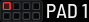

| Part | Design units | Colour | Note |
|---|---|---|---|
| pad 1 | 4.0, 3.1; 11.6 x 11.6; stroke 1.7 | `#ff3b3b` |  |
| pad 2 | 18.2, 3.1; 11.6 x 11.6; stroke 1.7 | `#3d4044` |  |
| pad 3 | 32.4, 3.1; 11.6 x 11.6; stroke 1.7 | `#3d4044` |  |
| pad 4 | 46.6, 3.1; 11.6 x 11.6; stroke 1.7 | `#3d4044` |  |
| pad 5 | 4.0, 17.3; 11.6 x 11.6; stroke 1.7 | `#3d4044` |  |
| pad 6 | 18.2, 17.3; 11.6 x 11.6; stroke 1.7 | `#3d4044` |  |
| pad 7 | 32.4, 17.3; 11.6 x 11.6; stroke 1.7 | `#3d4044` |  |
| pad 8 | 46.6, 17.3; 11.6 x 11.6; stroke 1.7 | `#3d4044` |  |

**Lamp off**:  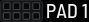

| Part | Design units | Colour | Note |
|---|---|---|---|
| pad 1 | 4.0, 3.1; 11.6 x 11.6; stroke 1.7 | `#3d4044` |  |
| pad 2 | 18.2, 3.1; 11.6 x 11.6; stroke 1.7 | `#3d4044` |  |
| pad 3 | 32.4, 3.1; 11.6 x 11.6; stroke 1.7 | `#3d4044` |  |
| pad 4 | 46.6, 3.1; 11.6 x 11.6; stroke 1.7 | `#3d4044` |  |
| pad 5 | 4.0, 17.3; 11.6 x 11.6; stroke 1.7 | `#3d4044` |  |
| pad 6 | 18.2, 17.3; 11.6 x 11.6; stroke 1.7 | `#3d4044` |  |
| pad 7 | 32.4, 17.3; 11.6 x 11.6; stroke 1.7 | `#3d4044` |  |
| pad 8 | 46.6, 17.3; 11.6 x 11.6; stroke 1.7 | `#3d4044` |  |

## Pad 2 (`pad-2`)

Where: each deck, pad 2 of 8 (top row 1 to 4, bottom row 5 to 8). Text after it: `PAD 2`.

**Lit**:  

| Part | Design units | Colour | Note |
|---|---|---|---|
| pad 1 | 4.0, 3.1; 11.6 x 11.6; stroke 1.7 | `#3d4044` |  |
| pad 2 | 18.2, 3.1; 11.6 x 11.6; stroke 1.7 | `#33d6ff` |  |
| pad 3 | 32.4, 3.1; 11.6 x 11.6; stroke 1.7 | `#3d4044` |  |
| pad 4 | 46.6, 3.1; 11.6 x 11.6; stroke 1.7 | `#3d4044` |  |
| pad 5 | 4.0, 17.3; 11.6 x 11.6; stroke 1.7 | `#3d4044` |  |
| pad 6 | 18.2, 17.3; 11.6 x 11.6; stroke 1.7 | `#3d4044` |  |
| pad 7 | 32.4, 17.3; 11.6 x 11.6; stroke 1.7 | `#3d4044` |  |
| pad 8 | 46.6, 17.3; 11.6 x 11.6; stroke 1.7 | `#3d4044` |  |

**Lamp off**: 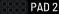 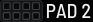

| Part | Design units | Colour | Note |
|---|---|---|---|
| pad 1 | 4.0, 3.1; 11.6 x 11.6; stroke 1.7 | `#3d4044` |  |
| pad 2 | 18.2, 3.1; 11.6 x 11.6; stroke 1.7 | `#3d4044` |  |
| pad 3 | 32.4, 3.1; 11.6 x 11.6; stroke 1.7 | `#3d4044` |  |
| pad 4 | 46.6, 3.1; 11.6 x 11.6; stroke 1.7 | `#3d4044` |  |
| pad 5 | 4.0, 17.3; 11.6 x 11.6; stroke 1.7 | `#3d4044` |  |
| pad 6 | 18.2, 17.3; 11.6 x 11.6; stroke 1.7 | `#3d4044` |  |
| pad 7 | 32.4, 17.3; 11.6 x 11.6; stroke 1.7 | `#3d4044` |  |
| pad 8 | 46.6, 17.3; 11.6 x 11.6; stroke 1.7 | `#3d4044` |  |

## Pad 3 (`pad-3`)

Where: each deck, pad 3 of 8 (top row 1 to 4, bottom row 5 to 8). Text after it: `PAD 3`.

**Lit**: 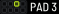 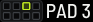

| Part | Design units | Colour | Note |
|---|---|---|---|
| pad 1 | 4.0, 3.1; 11.6 x 11.6; stroke 1.7 | `#3d4044` |  |
| pad 2 | 18.2, 3.1; 11.6 x 11.6; stroke 1.7 | `#3d4044` |  |
| pad 3 | 32.4, 3.1; 11.6 x 11.6; stroke 1.7 | `#c6f024` |  |
| pad 4 | 46.6, 3.1; 11.6 x 11.6; stroke 1.7 | `#3d4044` |  |
| pad 5 | 4.0, 17.3; 11.6 x 11.6; stroke 1.7 | `#3d4044` |  |
| pad 6 | 18.2, 17.3; 11.6 x 11.6; stroke 1.7 | `#3d4044` |  |
| pad 7 | 32.4, 17.3; 11.6 x 11.6; stroke 1.7 | `#3d4044` |  |
| pad 8 | 46.6, 17.3; 11.6 x 11.6; stroke 1.7 | `#3d4044` |  |

**Lamp off**: 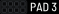 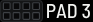

| Part | Design units | Colour | Note |
|---|---|---|---|
| pad 1 | 4.0, 3.1; 11.6 x 11.6; stroke 1.7 | `#3d4044` |  |
| pad 2 | 18.2, 3.1; 11.6 x 11.6; stroke 1.7 | `#3d4044` |  |
| pad 3 | 32.4, 3.1; 11.6 x 11.6; stroke 1.7 | `#3d4044` |  |
| pad 4 | 46.6, 3.1; 11.6 x 11.6; stroke 1.7 | `#3d4044` |  |
| pad 5 | 4.0, 17.3; 11.6 x 11.6; stroke 1.7 | `#3d4044` |  |
| pad 6 | 18.2, 17.3; 11.6 x 11.6; stroke 1.7 | `#3d4044` |  |
| pad 7 | 32.4, 17.3; 11.6 x 11.6; stroke 1.7 | `#3d4044` |  |
| pad 8 | 46.6, 17.3; 11.6 x 11.6; stroke 1.7 | `#3d4044` |  |

## Pad 4 (`pad-4`)

Where: each deck, pad 4 of 8 (top row 1 to 4, bottom row 5 to 8). Text after it: `PAD 4`.

**Lit**:  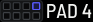

| Part | Design units | Colour | Note |
|---|---|---|---|
| pad 1 | 4.0, 3.1; 11.6 x 11.6; stroke 1.7 | `#3d4044` |  |
| pad 2 | 18.2, 3.1; 11.6 x 11.6; stroke 1.7 | `#3d4044` |  |
| pad 3 | 32.4, 3.1; 11.6 x 11.6; stroke 1.7 | `#3d4044` |  |
| pad 4 | 46.6, 3.1; 11.6 x 11.6; stroke 1.7 | `#5a5cff` |  |
| pad 5 | 4.0, 17.3; 11.6 x 11.6; stroke 1.7 | `#3d4044` |  |
| pad 6 | 18.2, 17.3; 11.6 x 11.6; stroke 1.7 | `#3d4044` |  |
| pad 7 | 32.4, 17.3; 11.6 x 11.6; stroke 1.7 | `#3d4044` |  |
| pad 8 | 46.6, 17.3; 11.6 x 11.6; stroke 1.7 | `#3d4044` |  |

**Lamp off**: 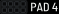 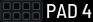

| Part | Design units | Colour | Note |
|---|---|---|---|
| pad 1 | 4.0, 3.1; 11.6 x 11.6; stroke 1.7 | `#3d4044` |  |
| pad 2 | 18.2, 3.1; 11.6 x 11.6; stroke 1.7 | `#3d4044` |  |
| pad 3 | 32.4, 3.1; 11.6 x 11.6; stroke 1.7 | `#3d4044` |  |
| pad 4 | 46.6, 3.1; 11.6 x 11.6; stroke 1.7 | `#3d4044` |  |
| pad 5 | 4.0, 17.3; 11.6 x 11.6; stroke 1.7 | `#3d4044` |  |
| pad 6 | 18.2, 17.3; 11.6 x 11.6; stroke 1.7 | `#3d4044` |  |
| pad 7 | 32.4, 17.3; 11.6 x 11.6; stroke 1.7 | `#3d4044` |  |
| pad 8 | 46.6, 17.3; 11.6 x 11.6; stroke 1.7 | `#3d4044` |  |

## Pad 5 (`pad-5`)

Where: each deck, pad 5 of 8 (top row 1 to 4, bottom row 5 to 8). Text after it: `PAD 5`.

**Lit**: 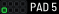 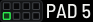

| Part | Design units | Colour | Note |
|---|---|---|---|
| pad 1 | 4.0, 3.1; 11.6 x 11.6; stroke 1.7 | `#3d4044` |  |
| pad 2 | 18.2, 3.1; 11.6 x 11.6; stroke 1.7 | `#3d4044` |  |
| pad 3 | 32.4, 3.1; 11.6 x 11.6; stroke 1.7 | `#3d4044` |  |
| pad 4 | 46.6, 3.1; 11.6 x 11.6; stroke 1.7 | `#3d4044` |  |
| pad 5 | 4.0, 17.3; 11.6 x 11.6; stroke 1.7 | `#2ee84e` |  |
| pad 6 | 18.2, 17.3; 11.6 x 11.6; stroke 1.7 | `#3d4044` |  |
| pad 7 | 32.4, 17.3; 11.6 x 11.6; stroke 1.7 | `#3d4044` |  |
| pad 8 | 46.6, 17.3; 11.6 x 11.6; stroke 1.7 | `#3d4044` |  |

**Lamp off**: 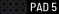 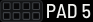

| Part | Design units | Colour | Note |
|---|---|---|---|
| pad 1 | 4.0, 3.1; 11.6 x 11.6; stroke 1.7 | `#3d4044` |  |
| pad 2 | 18.2, 3.1; 11.6 x 11.6; stroke 1.7 | `#3d4044` |  |
| pad 3 | 32.4, 3.1; 11.6 x 11.6; stroke 1.7 | `#3d4044` |  |
| pad 4 | 46.6, 3.1; 11.6 x 11.6; stroke 1.7 | `#3d4044` |  |
| pad 5 | 4.0, 17.3; 11.6 x 11.6; stroke 1.7 | `#3d4044` |  |
| pad 6 | 18.2, 17.3; 11.6 x 11.6; stroke 1.7 | `#3d4044` |  |
| pad 7 | 32.4, 17.3; 11.6 x 11.6; stroke 1.7 | `#3d4044` |  |
| pad 8 | 46.6, 17.3; 11.6 x 11.6; stroke 1.7 | `#3d4044` |  |

## Pad 6 (`pad-6`)

Where: each deck, pad 6 of 8 (top row 1 to 4, bottom row 5 to 8). Text after it: `PAD 6`.

**Lit**: 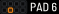 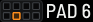

| Part | Design units | Colour | Note |
|---|---|---|---|
| pad 1 | 4.0, 3.1; 11.6 x 11.6; stroke 1.7 | `#3d4044` |  |
| pad 2 | 18.2, 3.1; 11.6 x 11.6; stroke 1.7 | `#3d4044` |  |
| pad 3 | 32.4, 3.1; 11.6 x 11.6; stroke 1.7 | `#3d4044` |  |
| pad 4 | 46.6, 3.1; 11.6 x 11.6; stroke 1.7 | `#3d4044` |  |
| pad 5 | 4.0, 17.3; 11.6 x 11.6; stroke 1.7 | `#3d4044` |  |
| pad 6 | 18.2, 17.3; 11.6 x 11.6; stroke 1.7 | `#ff8f1f` |  |
| pad 7 | 32.4, 17.3; 11.6 x 11.6; stroke 1.7 | `#3d4044` |  |
| pad 8 | 46.6, 17.3; 11.6 x 11.6; stroke 1.7 | `#3d4044` |  |

**Lamp off**: 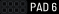 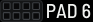

| Part | Design units | Colour | Note |
|---|---|---|---|
| pad 1 | 4.0, 3.1; 11.6 x 11.6; stroke 1.7 | `#3d4044` |  |
| pad 2 | 18.2, 3.1; 11.6 x 11.6; stroke 1.7 | `#3d4044` |  |
| pad 3 | 32.4, 3.1; 11.6 x 11.6; stroke 1.7 | `#3d4044` |  |
| pad 4 | 46.6, 3.1; 11.6 x 11.6; stroke 1.7 | `#3d4044` |  |
| pad 5 | 4.0, 17.3; 11.6 x 11.6; stroke 1.7 | `#3d4044` |  |
| pad 6 | 18.2, 17.3; 11.6 x 11.6; stroke 1.7 | `#3d4044` |  |
| pad 7 | 32.4, 17.3; 11.6 x 11.6; stroke 1.7 | `#3d4044` |  |
| pad 8 | 46.6, 17.3; 11.6 x 11.6; stroke 1.7 | `#3d4044` |  |

## Pad 7 (`pad-7`)

Where: each deck, pad 7 of 8 (top row 1 to 4, bottom row 5 to 8). Text after it: `PAD 7`.

**Lit**: 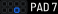 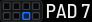

| Part | Design units | Colour | Note |
|---|---|---|---|
| pad 1 | 4.0, 3.1; 11.6 x 11.6; stroke 1.7 | `#3d4044` |  |
| pad 2 | 18.2, 3.1; 11.6 x 11.6; stroke 1.7 | `#3d4044` |  |
| pad 3 | 32.4, 3.1; 11.6 x 11.6; stroke 1.7 | `#3d4044` |  |
| pad 4 | 46.6, 3.1; 11.6 x 11.6; stroke 1.7 | `#3d4044` |  |
| pad 5 | 4.0, 17.3; 11.6 x 11.6; stroke 1.7 | `#3d4044` |  |
| pad 6 | 18.2, 17.3; 11.6 x 11.6; stroke 1.7 | `#3d4044` |  |
| pad 7 | 32.4, 17.3; 11.6 x 11.6; stroke 1.7 | `#1f74ff` |  |
| pad 8 | 46.6, 17.3; 11.6 x 11.6; stroke 1.7 | `#3d4044` |  |

**Lamp off**: 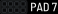 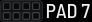

| Part | Design units | Colour | Note |
|---|---|---|---|
| pad 1 | 4.0, 3.1; 11.6 x 11.6; stroke 1.7 | `#3d4044` |  |
| pad 2 | 18.2, 3.1; 11.6 x 11.6; stroke 1.7 | `#3d4044` |  |
| pad 3 | 32.4, 3.1; 11.6 x 11.6; stroke 1.7 | `#3d4044` |  |
| pad 4 | 46.6, 3.1; 11.6 x 11.6; stroke 1.7 | `#3d4044` |  |
| pad 5 | 4.0, 17.3; 11.6 x 11.6; stroke 1.7 | `#3d4044` |  |
| pad 6 | 18.2, 17.3; 11.6 x 11.6; stroke 1.7 | `#3d4044` |  |
| pad 7 | 32.4, 17.3; 11.6 x 11.6; stroke 1.7 | `#3d4044` |  |
| pad 8 | 46.6, 17.3; 11.6 x 11.6; stroke 1.7 | `#3d4044` |  |

## Pad 8 (`pad-8`)

Where: each deck, pad 8 of 8 (top row 1 to 4, bottom row 5 to 8). Text after it: `PAD 8`.

**Lit**: 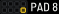 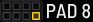

| Part | Design units | Colour | Note |
|---|---|---|---|
| pad 1 | 4.0, 3.1; 11.6 x 11.6; stroke 1.7 | `#3d4044` |  |
| pad 2 | 18.2, 3.1; 11.6 x 11.6; stroke 1.7 | `#3d4044` |  |
| pad 3 | 32.4, 3.1; 11.6 x 11.6; stroke 1.7 | `#3d4044` |  |
| pad 4 | 46.6, 3.1; 11.6 x 11.6; stroke 1.7 | `#3d4044` |  |
| pad 5 | 4.0, 17.3; 11.6 x 11.6; stroke 1.7 | `#3d4044` |  |
| pad 6 | 18.2, 17.3; 11.6 x 11.6; stroke 1.7 | `#3d4044` |  |
| pad 7 | 32.4, 17.3; 11.6 x 11.6; stroke 1.7 | `#3d4044` |  |
| pad 8 | 46.6, 17.3; 11.6 x 11.6; stroke 1.7 | `#ffd426` |  |

**Lamp off**: 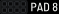 

| Part | Design units | Colour | Note |
|---|---|---|---|
| pad 1 | 4.0, 3.1; 11.6 x 11.6; stroke 1.7 | `#3d4044` |  |
| pad 2 | 18.2, 3.1; 11.6 x 11.6; stroke 1.7 | `#3d4044` |  |
| pad 3 | 32.4, 3.1; 11.6 x 11.6; stroke 1.7 | `#3d4044` |  |
| pad 4 | 46.6, 3.1; 11.6 x 11.6; stroke 1.7 | `#3d4044` |  |
| pad 5 | 4.0, 17.3; 11.6 x 11.6; stroke 1.7 | `#3d4044` |  |
| pad 6 | 18.2, 17.3; 11.6 x 11.6; stroke 1.7 | `#3d4044` |  |
| pad 7 | 32.4, 17.3; 11.6 x 11.6; stroke 1.7 | `#3d4044` |  |
| pad 8 | 46.6, 17.3; 11.6 x 11.6; stroke 1.7 | `#3d4044` |  |

## Pads in BEAT LOOP (`pads-beat-loop`)

Where: pad colours the firmware sets in BEAT LOOP (native_led.h, provisional). Text after it: `PADS IN BEAT LOOP`.

**Lit**:  

| Part | Design units | Colour | Note |
|---|---|---|---|
| pad 1 | 4.0, 3.1; 11.6 x 11.6; stroke 1.7 | `#ff6000` |  |
| pad 2 | 18.2, 3.1; 11.6 x 11.6; stroke 1.7 | `#ff6000` |  |
| pad 3 | 32.4, 3.1; 11.6 x 11.6; stroke 1.7 | `#ff6000` |  |
| pad 4 | 46.6, 3.1; 11.6 x 11.6; stroke 1.7 | `#ff6000` |  |
| pad 5 | 4.0, 17.3; 11.6 x 11.6; stroke 1.7 | `#ff6000` |  |
| pad 6 | 18.2, 17.3; 11.6 x 11.6; stroke 1.7 | `#ff6000` |  |
| pad 7 | 32.4, 17.3; 11.6 x 11.6; stroke 1.7 | `#ff6000` |  |
| pad 8 | 46.6, 17.3; 11.6 x 11.6; stroke 1.7 | `#ff6000` |  |

**Lamp off**:  

| Part | Design units | Colour | Note |
|---|---|---|---|
| pad 1 | 4.0, 3.1; 11.6 x 11.6; stroke 1.7 | `#3d4044` |  |
| pad 2 | 18.2, 3.1; 11.6 x 11.6; stroke 1.7 | `#3d4044` |  |
| pad 3 | 32.4, 3.1; 11.6 x 11.6; stroke 1.7 | `#3d4044` |  |
| pad 4 | 46.6, 3.1; 11.6 x 11.6; stroke 1.7 | `#3d4044` |  |
| pad 5 | 4.0, 17.3; 11.6 x 11.6; stroke 1.7 | `#3d4044` |  |
| pad 6 | 18.2, 17.3; 11.6 x 11.6; stroke 1.7 | `#3d4044` |  |
| pad 7 | 32.4, 17.3; 11.6 x 11.6; stroke 1.7 | `#3d4044` |  |
| pad 8 | 46.6, 17.3; 11.6 x 11.6; stroke 1.7 | `#3d4044` |  |

## Pads in SLIP LOOP (`pads-slip-loop`)

Where: pad colours the firmware sets in SLIP LOOP (native_led.h, provisional). Text after it: `PADS IN SLIP LOOP`.

**Lit**:  

| Part | Design units | Colour | Note |
|---|---|---|---|
| pad 1 | 4.0, 3.1; 11.6 x 11.6; stroke 1.7 | `#0060ff` |  |
| pad 2 | 18.2, 3.1; 11.6 x 11.6; stroke 1.7 | `#0060ff` |  |
| pad 3 | 32.4, 3.1; 11.6 x 11.6; stroke 1.7 | `#0060ff` |  |
| pad 4 | 46.6, 3.1; 11.6 x 11.6; stroke 1.7 | `#0060ff` |  |
| pad 5 | 4.0, 17.3; 11.6 x 11.6; stroke 1.7 | `#0060ff` |  |
| pad 6 | 18.2, 17.3; 11.6 x 11.6; stroke 1.7 | `#0060ff` |  |
| pad 7 | 32.4, 17.3; 11.6 x 11.6; stroke 1.7 | `#0060ff` |  |
| pad 8 | 46.6, 17.3; 11.6 x 11.6; stroke 1.7 | `#0060ff` |  |

**Lamp off**:  

| Part | Design units | Colour | Note |
|---|---|---|---|
| pad 1 | 4.0, 3.1; 11.6 x 11.6; stroke 1.7 | `#3d4044` |  |
| pad 2 | 18.2, 3.1; 11.6 x 11.6; stroke 1.7 | `#3d4044` |  |
| pad 3 | 32.4, 3.1; 11.6 x 11.6; stroke 1.7 | `#3d4044` |  |
| pad 4 | 46.6, 3.1; 11.6 x 11.6; stroke 1.7 | `#3d4044` |  |
| pad 5 | 4.0, 17.3; 11.6 x 11.6; stroke 1.7 | `#3d4044` |  |
| pad 6 | 18.2, 17.3; 11.6 x 11.6; stroke 1.7 | `#3d4044` |  |
| pad 7 | 32.4, 17.3; 11.6 x 11.6; stroke 1.7 | `#3d4044` |  |
| pad 8 | 46.6, 17.3; 11.6 x 11.6; stroke 1.7 | `#3d4044` |  |

## Pads in BEAT JUMP (`pads-beat-jump`)

Where: pad colours the firmware sets in BEAT JUMP page 2 (native_led.h xz_jump_page2_color). Text after it: `PADS IN BEAT JUMP`.

**Lit**:  

| Part | Design units | Colour | Note |
|---|---|---|---|
| pad 1 | 4.0, 3.1; 11.6 x 11.6; stroke 1.7 | `#ff3000` |  |
| pad 2 | 18.2, 3.1; 11.6 x 11.6; stroke 1.7 | `#ff3000` |  |
| pad 3 | 32.4, 3.1; 11.6 x 11.6; stroke 1.7 | `#ffa300` |  |
| pad 4 | 46.6, 3.1; 11.6 x 11.6; stroke 1.7 | `#ffa300` |  |
| pad 5 | 4.0, 17.3; 11.6 x 11.6; stroke 1.7 | `#ffa300` |  |
| pad 6 | 18.2, 17.3; 11.6 x 11.6; stroke 1.7 | `#ffa300` |  |
| pad 7 | 32.4, 17.3; 11.6 x 11.6; stroke 1.7 | `#ff3000` |  |
| pad 8 | 46.6, 17.3; 11.6 x 11.6; stroke 1.7 | `#ff3000` |  |

**Lamp off**:  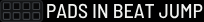

| Part | Design units | Colour | Note |
|---|---|---|---|
| pad 1 | 4.0, 3.1; 11.6 x 11.6; stroke 1.7 | `#3d4044` |  |
| pad 2 | 18.2, 3.1; 11.6 x 11.6; stroke 1.7 | `#3d4044` |  |
| pad 3 | 32.4, 3.1; 11.6 x 11.6; stroke 1.7 | `#3d4044` |  |
| pad 4 | 46.6, 3.1; 11.6 x 11.6; stroke 1.7 | `#3d4044` |  |
| pad 5 | 4.0, 17.3; 11.6 x 11.6; stroke 1.7 | `#3d4044` |  |
| pad 6 | 18.2, 17.3; 11.6 x 11.6; stroke 1.7 | `#3d4044` |  |
| pad 7 | 32.4, 17.3; 11.6 x 11.6; stroke 1.7 | `#3d4044` |  |
| pad 8 | 46.6, 17.3; 11.6 x 11.6; stroke 1.7 | `#3d4044` |  |

## BROWSE (`browse`)

Where: above the screen; hold: SEARCH. Text after it: `BROWSE`.

**Lit**:  

| Part | Design units | Colour | Note |
|---|---|---|---|
| rect | 5.2, 3.5; 69.6 x 25.0 | `#0b0b0c` | cap |
| outline | 6.3, 4.6; 67.4 x 22.8; stroke 1.9 | `#c9f522` |  |

**Lamp off**:  

| Part | Design units | Colour | Note |
|---|---|---|---|
| rect | 5.2, 3.5; 69.6 x 25.0 | `#0b0b0c` | cap |
| outline | 6.3, 4.6; 67.4 x 22.8; stroke 1.9 | `#3d4044` |  |

## TAG LIST (`tag-list`)

Where: above the screen. Text after it: `TAG LIST`.

**Lit**:  

| Part | Design units | Colour | Note |
|---|---|---|---|
| rect | 5.2, 3.5; 72.8 x 25.0 | `#0b0b0c` | cap |
| outline | 6.3, 4.6; 70.6 x 22.8; stroke 1.9 | `#c9f522` |  |

**Lamp off**:  

| Part | Design units | Colour | Note |
|---|---|---|---|
| rect | 5.2, 3.5; 72.8 x 25.0 | `#0b0b0c` | cap |
| outline | 6.3, 4.6; 70.6 x 22.8; stroke 1.9 | `#3d4044` |  |

## INFO (`info`)

Where: above the screen. Text after it: `INFO`.

**Lit**:  

| Part | Design units | Colour | Note |
|---|---|---|---|
| rect | 5.2, 3.5; 43.6 x 25.0 | `#0b0b0c` | cap |
| outline | 6.3, 4.6; 41.4 x 22.8; stroke 1.9 | `#c9f522` |  |

**Lamp off**:  

| Part | Design units | Colour | Note |
|---|---|---|---|
| rect | 5.2, 3.5; 43.6 x 25.0 | `#0b0b0c` | cap |
| outline | 6.3, 4.6; 41.4 x 22.8; stroke 1.9 | `#3d4044` |  |

## MENU (`menu`)

Where: above the screen; hold: UTILITY. Text after it: `MENU`.

**Lit**:  

| Part | Design units | Colour | Note |
|---|---|---|---|
| rect | 5.2, 3.5; 50.5 x 25.0 | `#0b0b0c` | cap |
| outline | 6.3, 4.6; 48.3 x 22.8; stroke 1.9 | `#c9f522` |  |

**Lamp off**:  

| Part | Design units | Colour | Note |
|---|---|---|---|
| rect | 5.2, 3.5; 50.5 x 25.0 | `#0b0b0c` | cap |
| outline | 6.3, 4.6; 48.3 x 22.8; stroke 1.9 | `#3d4044` |  |

## rekordbox (`rekordbox`)

Where: left of the screen, top; the media button above LINK. Text after it: `rekordbox`.

**Lit**:  

| Part | Design units | Colour | Note |
|---|---|---|---|
| rect | 5.2, 3.5; 81.8 x 25.0 | `#0b0b0c` | cap |
| outline | 6.3, 4.6; 79.6 x 22.8; stroke 1.9 | `#e9e9e9` |  |

**Lamp off**:  

| Part | Design units | Colour | Note |
|---|---|---|---|
| rect | 5.2, 3.5; 81.8 x 25.0 | `#0b0b0c` | cap |
| outline | 6.3, 4.6; 79.6 x 22.8; stroke 1.9 | `#3d4044` |  |

## LINK (`link`)

Where: left of the screen, below rekordbox. Text after it: `LINK`.

**Lit**:  

| Part | Design units | Colour | Note |
|---|---|---|---|
| rect | 5.2, 3.5; 43.6 x 25.0 | `#0b0b0c` | cap |
| outline | 6.3, 4.6; 41.4 x 22.8; stroke 1.9 | `#1ab8ff` |  |

**Lamp off**:  

| Part | Design units | Colour | Note |
|---|---|---|---|
| rect | 5.2, 3.5; 43.6 x 25.0 | `#0b0b0c` | cap |
| outline | 6.3, 4.6; 41.4 x 22.8; stroke 1.9 | `#3d4044` |  |

## USB 1 (`usb-1`)

Where: left of the screen. Text after it: `USB 1`.

**Lit**:  

| Part | Design units | Colour | Note |
|---|---|---|---|
| rect | 5.2, 3.5; 48.4 x 25.0 | `#0b0b0c` | cap |
| outline | 6.3, 4.6; 46.2 x 22.8; stroke 1.9 | `#c9f522` |  |

**Lamp off**: 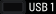 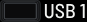

| Part | Design units | Colour | Note |
|---|---|---|---|
| rect | 5.2, 3.5; 48.4 x 25.0 | `#0b0b0c` | cap |
| outline | 6.3, 4.6; 46.2 x 22.8; stroke 1.9 | `#3d4044` |  |

## USB 2 (`usb-2`)

Where: left of the screen. Text after it: `USB 2`.

**Lit**: 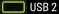 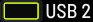

| Part | Design units | Colour | Note |
|---|---|---|---|
| rect | 5.2, 3.5; 51.1 x 25.0 | `#0b0b0c` | cap |
| outline | 6.3, 4.6; 48.9 x 22.8; stroke 1.9 | `#c9f522` |  |

**Lamp off**: 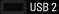 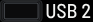

| Part | Design units | Colour | Note |
|---|---|---|---|
| rect | 5.2, 3.5; 51.1 x 25.0 | `#0b0b0c` | cap |
| outline | 6.3, 4.6; 48.9 x 22.8; stroke 1.9 | `#3d4044` |  |

## BACK (`back`)

Where: round the rotary selector, top left; BACK printed above. Text after it: `BACK`.

**No lamp**:  

| Part | Design units | Colour | Note |
|---|---|---|---|
| rect | 4.0, 0.5; 11.9 x 14.9 | `#c4c7cb` | the back key, drawn light |
| circle | centre 16.5, 16.0; r 9.9 | `#060607` | black surround over the keys |
| ring | centre 16.5, 16.0; r 7.9; stroke 2.0 | `#dfe1e3` | light ring round the knob |
| circle | centre 16.5, 16.0; r 5.3 | `#0b0b0c` | knurled knob |

## TAG TRACK/REMOVE (`tag-track`)

Where: round the rotary selector, top right. Text after it: `TAG TRACK/REMOVE`.

**No lamp**:  

| Part | Design units | Colour | Note |
|---|---|---|---|
| rect | 17.1, 0.5; 11.9 x 14.9 | `#c4c7cb` | the tag-track key, drawn light |
| circle | centre 16.5, 16.0; r 9.9 | `#060607` | black surround over the keys |
| ring | centre 16.5, 16.0; r 7.9; stroke 2.0 | `#dfe1e3` | light ring round the knob |
| circle | centre 16.5, 16.0; r 5.3 | `#0b0b0c` | knurled knob |

## TRACK FILTER/EDIT (`track-filter`)

Where: round the rotary selector, bottom left; TRACK FILTER printed below, hold: EDIT. Text after it: `TRACK FILTER`.

**No lamp**:  

| Part | Design units | Colour | Note |
|---|---|---|---|
| rect | 4.0, 16.6; 11.9 x 14.9 | `#c4c7cb` | the track-filter key, drawn light |
| circle | centre 16.5, 16.0; r 9.9 | `#060607` | black surround over the keys |
| ring | centre 16.5, 16.0; r 7.9; stroke 2.0 | `#dfe1e3` | light ring round the knob |
| circle | centre 16.5, 16.0; r 5.3 | `#0b0b0c` | knurled knob |

## SHORTCUT (`shortcut`)

Where: round the rotary selector, bottom right; SHORT CUT printed below. Text after it: `SHORTCUT`.

**No lamp**:  

| Part | Design units | Colour | Note |
|---|---|---|---|
| rect | 17.1, 16.6; 11.9 x 14.9 | `#c4c7cb` | the shortcut key, drawn light |
| circle | centre 16.5, 16.0; r 9.9 | `#060607` | black surround over the keys |
| ring | centre 16.5, 16.0; r 7.9; stroke 2.0 | `#dfe1e3` | light ring round the knob |
| circle | centre 16.5, 16.0; r 5.3 | `#0b0b0c` | knurled knob |

## Rotary selector (`rotary`)

Where: right of the screen. Text after it: `ROTARY SELECTOR`.

**No lamp**:  

| Part | Design units | Colour | Note |
|---|---|---|---|
| circle | centre 16.5, 16.0; r 9.9 | `#060607` | black surround over the keys |
| ring | centre 16.5, 16.0; r 7.9; stroke 2.0 | `#dfe1e3` | light ring round the knob |
| circle | centre 16.5, 16.0; r 5.3 | `#0b0b0c` | knurled knob |

## Turn the rotary selector (`rotary-turn`)

Where: right of the screen. Text after it: `TURN THE ROTARY SELECTOR`.

**No lamp**:  

| Part | Design units | Colour | Note |
|---|---|---|---|
| circle | centre 16.5, 16.0; r 9.9 | `#060607` | black surround over the keys |
| ring | centre 16.5, 16.0; r 7.9; stroke 2.0 | `#dfe1e3` | light ring round the knob |
| circle | centre 16.5, 16.0; r 5.3 | `#0b0b0c` | knurled knob |
| symbol turn arrows | round the knob | `#f1f2f0` |  |

## Push the rotary selector (`rotary-push`)

Where: right of the screen. Text after it: `PUSH THE ROTARY SELECTOR`.

**No lamp**:  

| Part | Design units | Colour | Note |
|---|---|---|---|
| circle | centre 16.5, 16.0; r 9.9 | `#060607` | black surround over the keys |
| ring | centre 16.5, 16.0; r 7.9; stroke 2.0 | `#dfe1e3` | light ring round the knob |
| circle | centre 16.5, 16.0; r 5.3 | `#0b0b0c` | knurled knob |
| symbol push dot | round the knob | `#f1f2f0` |  |

## LOAD (`load`)

Where: below the rotary selector, one per side. Text after it: `LOAD`.

**No lamp**:  

| Part | Design units | Colour | Note |
|---|---|---|---|
| rect | 48.1, 4.5; 21.0 x 23.0 | `#0b0b0c` | cap |
| outline | 49.2, 5.6; 18.8 x 20.8; stroke 1.9 | `#f1f2f0` |  |
| rect | 74.5, 4.5; 21.0 x 23.0 | `#0b0b0c` | cap |
| outline | 75.6, 5.6; 18.8 x 20.8; stroke 1.9 | `#f1f2f0` |  |

## LOAD 1 (`load-1`)

Where: below the rotary selector, left. Text after it: `LOAD 1`.

**No lamp**:  

| Part | Design units | Colour | Note |
|---|---|---|---|
| rect | 48.1, 4.5; 21.0 x 23.0 | `#0b0b0c` | cap |
| outline | 49.2, 5.6; 18.8 x 20.8; stroke 1.9 | `#f1f2f0` |  |

## LOAD 2 (`load-2`)

Where: below the rotary selector, right. Text after it: `LOAD 2`.

**No lamp**:  

| Part | Design units | Colour | Note |
|---|---|---|---|
| rect | 48.1, 4.5; 21.0 x 23.0 | `#0b0b0c` | cap |
| outline | 49.2, 5.6; 18.8 x 20.8; stroke 1.9 | `#f1f2f0` |  |

## TIME MODE (`time-mode`)

Where: left of the screen; press for TIME MODE, hold for AUTO CUE. Text after it: `TIME MODE`.

**No lamp**:  

| Part | Design units | Colour | Note |
|---|---|---|---|
| circle | centre 12.3, 16.0; r 7.0 | `#0b0b0c` | cap |

## AUTO CUE (`auto-cue`)

Where: left of the screen; the TIME MODE key, held. Text after it: `AUTO CUE`.

**No lamp**:  

| Part | Design units | Colour | Note |
|---|---|---|---|
| circle | centre 12.3, 16.0; r 7.0 | `#0b0b0c` | cap |

## DECK QUANTIZE (`deck-quantize`)

Where: left of the screen, below TIME MODE. Text after it: `DECK QUANTIZE`.

**Lit**:  

| Part | Design units | Colour | Note |
|---|---|---|---|
| circle | centre 12.3, 16.0; r 7.0 | `#0b0b0c` | cap |
| circle | centre 12.3, 16.0; r 2.5 | `#ff2424` | LED |

**Lamp off**:  

| Part | Design units | Colour | Note |
|---|---|---|---|
| circle | centre 12.3, 16.0; r 7.0 | `#0b0b0c` | cap |
| circle | centre 12.3, 16.0; r 2.5 | `#3e1515` | LED |

## USB STOP (`usb-stop`)

Where: below each top USB port; hold to stop a stick. Text after it: `USB STOP`.

**No lamp**:  

| Part | Design units | Colour | Note |
|---|---|---|---|
| circle | centre 12.3, 16.0; r 7.0 | `#0b0b0c` | cap |

## CH 3 INPUT (`ch3-input`)

Where: mixer, top left; USB (the computer symbol), LINE, PHONO. Text after it: `CH 3 INPUT`.

**No lamp**:  

| Part | Design units | Colour | Note |
|---|---|---|---|
| rect | 4.0, 14.0; 27.0 x 11.0 | `#050506` | slot |
| rect | 5.8, 15.2; 7.4 x 8.6 | `#202124` | lever at position 1 of 3 |

## CH 4 INPUT (`ch4-input`)

Where: mixer, top right; USB (the computer symbol), LINE, PHONO. Text after it: `CH 4 INPUT`.

**No lamp**:  

| Part | Design units | Colour | Note |
|---|---|---|---|
| rect | 4.0, 14.0; 27.0 x 11.0 | `#050506` | slot |
| rect | 5.8, 15.2; 7.4 x 8.6 | `#202124` | lever at position 1 of 3 |

## CUE (channel) (`channel-cue`)

Where: mixer, above each channel number; the headphone CUE. Text after it: `CUE (CHANNEL)`.

**Lit**:  

| Part | Design units | Colour | Note |
|---|---|---|---|
| rect | 5.3, 6.4; 33.3 x 19.2 | `#ffa21c` | whole cap lit |

**Lamp off**: 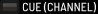 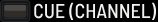

| Part | Design units | Colour | Note |
|---|---|---|---|
| rect | 5.3, 6.4; 33.3 x 19.2 | `#2f2c29` | cap, lamp off |

## CROSSFADER ASSIGN (`crossfader-assign`)

Where: mixer, below each channel fader; A, THRU, B. Text after it: `A THRU B`.

**No lamp**:  

| Part | Design units | Colour | Note |
|---|---|---|---|
| rect | 4.0, 14.0; 27.0 x 11.0 | `#050506` | slot |
| rect | 13.8, 15.2; 7.4 x 8.6 | `#202124` | lever at position 2 of 3 |

## BEAT ◀ ▶ (`beat`)

Where: BEAT FX, below the X-PAD. Text after it: `BEAT ◀ ▶`.

**No lamp**:  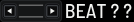

| Part | Design units | Colour | Note |
|---|---|---|---|
| rect | 5.2, 7.0; 18.0 x 18.0 | `#0b0b0c` | cap |
| outline | 6.3, 8.1; 15.8 x 15.8; stroke 1.9 | `#3d4044` |  |
| symbol prev | 5.6, 12.0; 16.0 x 8.0 | `#f1f2f0` |  |
| rect | 66.8, 7.0; 18.0 x 18.0 | `#0b0b0c` | cap |
| outline | 67.9, 8.1; 15.8 x 15.8; stroke 1.9 | `#3d4044` |  |
| symbol next | 68.4, 12.0; 16.0 x 8.0 | `#f1f2f0` |  |

## BEAT ◀ (`beat-back`)

Where: BEAT FX, below the X-PAD, left. Text after it: `BEAT ◀`.

**No lamp**:  

| Part | Design units | Colour | Note |
|---|---|---|---|
| rect | 5.2, 7.0; 18.0 x 18.0 | `#0b0b0c` | cap |
| outline | 6.3, 8.1; 15.8 x 15.8; stroke 1.9 | `#3d4044` |  |
| symbol prev | 5.6, 12.0; 16.0 x 8.0 | `#f1f2f0` |  |

## BEAT ▶ (`beat-forward`)

Where: BEAT FX, below the X-PAD, right. Text after it: `BEAT ▶`.

**No lamp**:  

| Part | Design units | Colour | Note |
|---|---|---|---|
| rect | 66.8, 7.0; 18.0 x 18.0 | `#0b0b0c` | cap |
| outline | 67.9, 8.1; 15.8 x 15.8; stroke 1.9 | `#3d4044` |  |
| symbol next | 68.4, 12.0; 16.0 x 8.0 | `#f1f2f0` |  |

## AUTO/TAP (`auto-tap`)

Where: BEAT FX, left of TAP. Text after it: `AUTO/TAP`.

**No lamp**:  

| Part | Design units | Colour | Note |
|---|---|---|---|
| circle | centre 12.3, 16.0; r 7.0 | `#0b0b0c` | cap |

## TAP (`tap`)

Where: BEAT FX. Text after it: `TAP`.

**Lit**:  

| Part | Design units | Colour | Note |
|---|---|---|---|
| ring | centre 16.0, 16.0; r 11.5; stroke 2.0 | `#27e35a` |  |
| circle | centre 16.0, 16.0; r 9.2 | `#0b0b0c` | cap |

**Lamp off**:  

| Part | Design units | Colour | Note |
|---|---|---|---|
| ring | centre 16.0, 16.0; r 11.5; stroke 2.0 | `#3a3d41` |  |
| circle | centre 16.0, 16.0; r 9.2 | `#0b0b0c` | cap |

## FX QUANTIZE (`fx-quantize`)

Where: BEAT FX, right of TAP. Text after it: `FX QUANTIZE`.

**Lit**:  

| Part | Design units | Colour | Note |
|---|---|---|---|
| circle | centre 12.3, 16.0; r 7.0 | `#0b0b0c` | cap |
| circle | centre 12.3, 16.0; r 2.5 | `#ff2424` | LED |

**Lamp off**:  

| Part | Design units | Colour | Note |
|---|---|---|---|
| circle | centre 12.3, 16.0; r 7.0 | `#0b0b0c` | cap |
| circle | centre 12.3, 16.0; r 2.5 | `#3e1515` | LED |

## FX FREQUENCY LOW (`fx-low`)

Where: BEAT FX, FX FREQUENCY row. Text after it: `FX FREQUENCY LOW`.

**Lit**:  

| Part | Design units | Colour | Note |
|---|---|---|---|
| rect | 5.2, 3.5; 42.0 x 25.0 | `#0b0b0c` | cap |
| outline | 6.3, 4.6; 39.8 x 22.8; stroke 1.9 | `#2f9bff` |  |

**Lamp off**:  

| Part | Design units | Colour | Note |
|---|---|---|---|
| rect | 5.2, 3.5; 42.0 x 25.0 | `#0b0b0c` | cap |
| outline | 6.3, 4.6; 39.8 x 22.8; stroke 1.9 | `#3d4044` |  |

## FX FREQUENCY MID (`fx-mid`)

Where: BEAT FX, FX FREQUENCY row. Text after it: `FX FREQUENCY MID`.

**Lit**:  

| Part | Design units | Colour | Note |
|---|---|---|---|
| rect | 5.2, 3.5; 35.8 x 25.0 | `#0b0b0c` | cap |
| outline | 6.3, 4.6; 33.6 x 22.8; stroke 1.9 | `#2f9bff` |  |

**Lamp off**:  

| Part | Design units | Colour | Note |
|---|---|---|---|
| rect | 5.2, 3.5; 35.8 x 25.0 | `#0b0b0c` | cap |
| outline | 6.3, 4.6; 33.6 x 22.8; stroke 1.9 | `#3d4044` |  |

## FX FREQUENCY HI (`fx-hi`)

Where: BEAT FX, FX FREQUENCY row. Text after it: `FX FREQUENCY HI`.

**Lit**:  

| Part | Design units | Colour | Note |
|---|---|---|---|
| rect | 5.2, 3.5; 25.4 x 25.0 | `#0b0b0c` | cap |
| outline | 6.3, 4.6; 23.2 x 22.8; stroke 1.9 | `#2f9bff` |  |

**Lamp off**:  

| Part | Design units | Colour | Note |
|---|---|---|---|
| rect | 5.2, 3.5; 25.4 x 25.0 | `#0b0b0c` | cap |
| outline | 6.3, 4.6; 23.2 x 22.8; stroke 1.9 | `#3d4044` |  |

## ON/OFF (`fx-on-off`)

Where: BEAT FX, bottom. Text after it: `ON/OFF`.

**Lit**:  

| Part | Design units | Colour | Note |
|---|---|---|---|
| circle | centre 16.8, 16.0; r 11.5 | `#2a8cff` | whole cap lit |

**Lamp off**:  

| Part | Design units | Colour | Note |
|---|---|---|---|
| circle | centre 16.8, 16.0; r 11.5 | `#1e1e20` | cap, lamp off |

## SPACE (`color-space`)

Where: mixer, SOUND COLOR FX. Text after it: `SPACE`.

**Lit**:  

| Part | Design units | Colour | Note |
|---|---|---|---|
| rect | 5.2, 3.5; 52.7 x 25.0 | `#0b0b0c` | cap |
| outline | 6.3, 4.6; 50.5 x 22.8; stroke 1.9 | `#f0f0f0` |  |

**Lamp off**:  

| Part | Design units | Colour | Note |
|---|---|---|---|
| rect | 5.2, 3.5; 52.7 x 25.0 | `#0b0b0c` | cap |
| outline | 6.3, 4.6; 50.5 x 22.8; stroke 1.9 | `#3d4044` |  |

## DUB ECHO (`color-dub-echo`)

Where: mixer, SOUND COLOR FX. Text after it: `DUB ECHO`.

**Lit**:  

| Part | Design units | Colour | Note |
|---|---|---|---|
| rect | 5.2, 3.5; 74.9 x 25.0 | `#0b0b0c` | cap |
| outline | 6.3, 4.6; 72.7 x 22.8; stroke 1.9 | `#f0f0f0` |  |

**Lamp off**:  

| Part | Design units | Colour | Note |
|---|---|---|---|
| rect | 5.2, 3.5; 74.9 x 25.0 | `#0b0b0c` | cap |
| outline | 6.3, 4.6; 72.7 x 22.8; stroke 1.9 | `#3d4044` |  |

## SWEEP (`color-sweep`)

Where: mixer, SOUND COLOR FX. Text after it: `SWEEP`.

**Lit**:  

| Part | Design units | Colour | Note |
|---|---|---|---|
| rect | 5.2, 3.5; 55.9 x 25.0 | `#0b0b0c` | cap |
| outline | 6.3, 4.6; 53.7 x 22.8; stroke 1.9 | `#f0f0f0` |  |

**Lamp off**:  

| Part | Design units | Colour | Note |
|---|---|---|---|
| rect | 5.2, 3.5; 55.9 x 25.0 | `#0b0b0c` | cap |
| outline | 6.3, 4.6; 53.7 x 22.8; stroke 1.9 | `#3d4044` |  |

## NOISE (`color-noise`)

Where: mixer, SOUND COLOR FX. Text after it: `NOISE`.

**Lit**:  

| Part | Design units | Colour | Note |
|---|---|---|---|
| rect | 5.2, 3.5; 49.6 x 25.0 | `#0b0b0c` | cap |
| outline | 6.3, 4.6; 47.4 x 22.8; stroke 1.9 | `#f0f0f0` |  |

**Lamp off**:  

| Part | Design units | Colour | Note |
|---|---|---|---|
| rect | 5.2, 3.5; 49.6 x 25.0 | `#0b0b0c` | cap |
| outline | 6.3, 4.6; 47.4 x 22.8; stroke 1.9 | `#3d4044` |  |

## CRUSH (`color-crush`)

Where: mixer, SOUND COLOR FX. Text after it: `CRUSH`.

**Lit**:  

| Part | Design units | Colour | Note |
|---|---|---|---|
| rect | 5.2, 3.5; 53.9 x 25.0 | `#0b0b0c` | cap |
| outline | 6.3, 4.6; 51.7 x 22.8; stroke 1.9 | `#f0f0f0` |  |

**Lamp off**:  

| Part | Design units | Colour | Note |
|---|---|---|---|
| rect | 5.2, 3.5; 53.9 x 25.0 | `#0b0b0c` | cap |
| outline | 6.3, 4.6; 51.7 x 22.8; stroke 1.9 | `#3d4044` |  |

## FILTER (`color-filter`)

Where: mixer, SOUND COLOR FX. Text after it: `FILTER`.

**Lit**:  

| Part | Design units | Colour | Note |
|---|---|---|---|
| rect | 5.2, 3.5; 55.7 x 25.0 | `#0b0b0c` | cap |
| outline | 6.3, 4.6; 53.5 x 22.8; stroke 1.9 | `#f0f0f0` |  |

**Lamp off**:  

| Part | Design units | Colour | Note |
|---|---|---|---|
| rect | 5.2, 3.5; 55.7 x 25.0 | `#0b0b0c` | cap |
| outline | 6.3, 4.6; 53.5 x 22.8; stroke 1.9 | `#3d4044` |  |

