# Button glyphs

Generated by `python tools/xz_buttons.py write` from `GLYPHS` in `tools/xz_buttons.py`. Do not edit by hand.
Pictures: `ui/assets/buttons/<id>.svg` (in text) and `<id>.panel.svg` (with the panel print round it), `.off` for the lamp off.

| Glyph | Write | Also accepted | On the unit | Lamp |
|---|---|---|---|---|
| 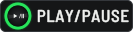 | `[[PLAY/PAUSE]]` | `[[PLAY]]`, `[[PLAY / PAUSE]]`, `[[▶/II]]` | each deck, bottom left; PLAY/PAUSE printed above | `#27e35a` |
|  | `[[CUE]]` | `[[CUE (deck)]]` | each deck, above PLAY/PAUSE | `#ff5f14` |
|  | `[[SYNC]]` | `[[BEAT SYNC]]`, `[[INST. DOUBLES]]` | each deck, BEAT SYNC pair right of the jog; hold for INST. DOUBLES | `#ececea` |
|  | `[[MASTER]]` | `[[BEAT SYNC MASTER]]` | each deck, BEAT SYNC pair, right of SYNC | `#ff5f14` |
|  | `[[MASTER TEMPO]]` | `[[KEY LOCK]]` | each deck, above the TEMPO slider; MASTER TEMPO printed above | `#ff2424` |
|  | `[[TEMPO ±6/±10/±16/WIDE]]` | `[[TEMPO RANGE]]`, `[[TEMPO]]` | each deck, top of the TEMPO slider column | none |
|  | `[[TEMPO RESET]]` |   | each deck, left of the TEMPO slider; its lamp is beside the slider | `#d6f53c` |
|  | `[[IN/CUE]]` | `[[LOOP IN]]`, `[[IN]]`, `[[IN ADJUST]]`, `[[IN / CUE]]` | each deck, top row; SHIFT: IN ADJUST | `#ffb11a` |
|  | `[[OUT]]` | `[[LOOP OUT]]`, `[[OUT ADJUST]]` | each deck, top row; SHIFT: OUT ADJUST | `#ffb11a` |
|  | `[[RELOOP/EXIT]]` | `[[RELOOP]]`, `[[EXIT]]`, `[[RELOOP / EXIT]]` | each deck, top row | `#ffb11a` |
|  | `[[4/8BEAT]]` | `[[4BEAT/8BEAT]]`, `[[4/8 BEAT]]`, `[[LOOP CUTTER]]`, `[[4/8BEAT (LOOP CUTTER)]]` | each deck, left of the jog; LOOP CUTTER in a box below it | none |
|  | `[[CUE/LOOP CALL]]` | `[[CALL]]`, `[[CUE/LOOP CALL ◀ ▶]]`, `[[CALL ◀ ▶]]`, `[[LOOP 1/2X 2X]]` | each deck, top row; CALL printed above, 1/2X and 2X below | none |
|  | `[[CUE/LOOP CALL ◀]]` | `[[CALL ◀]]`, `[[1/2X]]` | each deck, top row; SHIFT: LOOP 1/2X | none |
|  | `[[CUE/LOOP CALL ▶]]` | `[[CALL ▶]]`, `[[2X]]` | each deck, top row; SHIFT: LOOP 2X | none |
|  | `[[DELETE]]` |   | each deck, top row | none |
|  | `[[MEMORY]]` |   | each deck, top row | none |
|  | `[[SLIP]]` |   | each deck, left of the jog | `#ff2424` |
|  | `[[DIRECTION REV]]` | `[[REV]]`, `[[DIRECTION]]`, `[[REVERSE]]` | each deck, left of the jog; DIRECTION printed above, REV on the cap | `#ff2424` |
|  | `[[VINYL]]` | `[[JOG MODE]]`, `[[VINYL (JOG MODE)]]` | each deck, JOG MODE, right of the jog | `#2f8bff` |
|  | `[[SHIFT]]` |   | each deck, left of the jog | none |
|  | `[[TRACK SEARCH]]` | `[[TRACK SEARCH |◀◀ ▶▶|]]`, `[[TRACK SEARCH ◀◀ ▶▶]]` | each deck, left of the jog | none |
|  | `[[SEARCH]]` | `[[SEARCH ◀◀ ▶▶]]`, `[[SEARCH (deck)]]` | each deck, below TRACK SEARCH | none |
|  | `[[HOT CUE]]` | `[[HOT CUE mode]]` | each deck, PAD MODE row above the pads; SHIFT: CALL | `#f2f2f2` |
|  | `[[BEAT LOOP]]` |   | each deck, PAD MODE row | `#36d4ff` |
|  | `[[SLIP LOOP]]` |   | each deck, PAD MODE row | `#1f8fff` |
|  | `[[BEAT JUMP]]` |   | each deck, PAD MODE row | `#ff2424` |
| 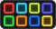 | `[[Performance pads]]` | `[[PADS]]`, `[[pads]]`, `[[PERFORMANCE PADS]]` | each deck, eight pads below PAD MODE (HOT CUE colours as photographed) | `#ffffff` |
| 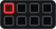 | `[[Pad 1]]` | `[[PAD 1]]`, `[[pad 1]]` | each deck, pad 1 of 8 (top row 1 to 4, bottom row 5 to 8) | `#ff3b3b` |
| 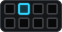 | `[[Pad 2]]` | `[[PAD 2]]`, `[[pad 2]]` | each deck, pad 2 of 8 (top row 1 to 4, bottom row 5 to 8) | `#33d6ff` |
| 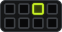 | `[[Pad 3]]` | `[[PAD 3]]`, `[[pad 3]]` | each deck, pad 3 of 8 (top row 1 to 4, bottom row 5 to 8) | `#c6f024` |
| 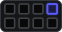 | `[[Pad 4]]` | `[[PAD 4]]`, `[[pad 4]]` | each deck, pad 4 of 8 (top row 1 to 4, bottom row 5 to 8) | `#5a5cff` |
| 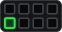 | `[[Pad 5]]` | `[[PAD 5]]`, `[[pad 5]]` | each deck, pad 5 of 8 (top row 1 to 4, bottom row 5 to 8) | `#2ee84e` |
| 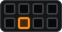 | `[[Pad 6]]` | `[[PAD 6]]`, `[[pad 6]]` | each deck, pad 6 of 8 (top row 1 to 4, bottom row 5 to 8) | `#ff8f1f` |
| 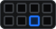 | `[[Pad 7]]` | `[[PAD 7]]`, `[[pad 7]]` | each deck, pad 7 of 8 (top row 1 to 4, bottom row 5 to 8) | `#1f74ff` |
| 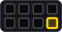 | `[[Pad 8]]` | `[[PAD 8]]`, `[[pad 8]]` | each deck, pad 8 of 8 (top row 1 to 4, bottom row 5 to 8) | `#ffd426` |
| 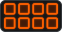 | `[[Pads in BEAT LOOP]]` |   | pad colours the firmware sets in BEAT LOOP (native_led.h, provisional) | `#ff6000` |
| 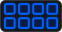 | `[[Pads in SLIP LOOP]]` |   | pad colours the firmware sets in SLIP LOOP (native_led.h, provisional) | `#0060ff` |
| 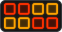 | `[[Pads in BEAT JUMP]]` |   | pad colours the firmware sets in BEAT JUMP page 2 (native_led.h xz_jump_page2_color) | `#ff3000` |
|  | `[[BROWSE]]` |   | above the screen; hold: SEARCH | `#c9f522` |
|  | `[[TAG LIST]]` |   | above the screen | `#c9f522` |
|  | `[[INFO]]` |   | above the screen | `#c9f522` |
|  | `[[MENU]]` | `[[UTILITY]]` | above the screen; hold: UTILITY | `#c9f522` |
|  | `[[rekordbox]]` | `[[REKORDBOX]]`, `[[rekordbox button]]` | left of the screen, top; the media button above LINK | `#f2f2f2` |
|  | `[[LINK]]` |   | left of the screen, below rekordbox | `#1ab8ff` |
|  | `[[USB 1]]` | `[[USB1]]` | left of the screen | `#c9f522` |
|  | `[[USB 2]]` | `[[USB2]]` | left of the screen | `#c9f522` |
|  | `[[BACK]]` |   | round the rotary selector, top left; BACK printed above | none |
|  | `[[TAG TRACK/REMOVE]]` | `[[TAG TRACK]]`, `[[TAG TRACK / REMOVE]]`, `[[REMOVE]]` | round the rotary selector, top right | none |
|  | `[[TRACK FILTER/EDIT]]` | `[[TRACK FILTER]]`, `[[EDIT]]`, `[[TRACK FILTER / EDIT]]` | round the rotary selector, bottom left; TRACK FILTER printed below, hold: EDIT | none |
|  | `[[SHORTCUT]]` | `[[SHORT CUT]]` | round the rotary selector, bottom right; SHORT CUT printed below | none |
|  | `[[Rotary selector]]` | `[[ROTARY]]`, `[[rotary selector]]`, `[[rotary encoder]]`, `[[ROTARY SELECTOR]]` | right of the screen | none |
|  | `[[Turn the rotary selector]]` | `[[TURN]]`, `[[turn the rotary selector]]` | right of the screen | none |
|  | `[[Push the rotary selector]]` | `[[PUSH]]`, `[[push the rotary selector]]` | right of the screen | none |
|  | `[[LOAD]]` | `[[LOAD 1, 2]]` | below the rotary selector, one per side | none |
|  | `[[LOAD 1]]` |   | below the rotary selector, left | none |
|  | `[[LOAD 2]]` |   | below the rotary selector, right | none |
|  | `[[TIME MODE]]` |   | left of the screen; press for TIME MODE, hold for AUTO CUE | none |
|  | `[[AUTO CUE]]` | `[[TIME MODE/AUTO CUE]]` | left of the screen; the TIME MODE key, held | none |
|  | `[[DECK QUANTIZE]]` | `[[QUANTIZE]]` | left of the screen, below TIME MODE | `#ff2424` |
|  | `[[USB STOP]]` |   | below each top USB port; hold to stop a stick | none |
| 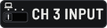 | `[[CH 3 INPUT]]` | `[[CH3 INPUT]]`, `[[CH3]]`, `[[CH 3]]` | mixer, top left; USB (the computer symbol), LINE, PHONO | none |
| 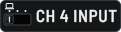 | `[[CH 4 INPUT]]` | `[[CH4 INPUT]]`, `[[CH4]]`, `[[CH 4]]` | mixer, top right; USB (the computer symbol), LINE, PHONO | none |
|  | `[[CUE (channel)]]` | `[[channel CUE]]`, `[[CH CUE]]`, `[[headphones CUE]]` | mixer, above each channel number; the headphone CUE | `#ffb11a` |
| 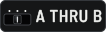 | `[[CROSSFADER ASSIGN]]` | `[[A THRU B]]`, `[[CROSSFADER ASSIGN A THRU B]]` | mixer, below each channel fader; A, THRU, B | none |
|  | `[[BEAT ◀ ▶]]` | `[[BEAT]]`, `[[BEAT ◀▶]]` | BEAT FX, below the X-PAD | none |
|  | `[[BEAT ◀]]` |   | BEAT FX, below the X-PAD, left | none |
|  | `[[BEAT ▶]]` |   | BEAT FX, below the X-PAD, right | none |
|  | `[[AUTO/TAP]]` | `[[AUTO / TAP]]` | BEAT FX, left of TAP | none |
|  | `[[TAP]]` |   | BEAT FX | `#27e35a` |
|  | `[[FX QUANTIZE]]` | `[[FX QUANTIZE]]` | BEAT FX, right of TAP | `#ff2424` |
|  | `[[FX FREQUENCY LOW]]` | `[[FX LOW]]` | BEAT FX, FX FREQUENCY row | `#2f8bff` |
|  | `[[FX FREQUENCY MID]]` | `[[FX MID]]` | BEAT FX, FX FREQUENCY row | `#2f8bff` |
|  | `[[FX FREQUENCY HI]]` | `[[FX HI]]` | BEAT FX, FX FREQUENCY row | `#2f8bff` |
|  | `[[ON/OFF]]` | `[[BEAT FX ON/OFF]]`, `[[FX ON/OFF]]`, `[[ON / OFF]]` | BEAT FX, bottom | `#2f8bff` |
|  | `[[SPACE]]` | `[[SOUND COLOR FX SPACE]]` | mixer, SOUND COLOR FX | `#f2f2f2` |
|  | `[[DUB ECHO]]` | `[[SOUND COLOR FX DUB ECHO]]` | mixer, SOUND COLOR FX | `#f2f2f2` |
|  | `[[SWEEP]]` | `[[SOUND COLOR FX SWEEP]]` | mixer, SOUND COLOR FX | `#f2f2f2` |
|  | `[[NOISE]]` | `[[SOUND COLOR FX NOISE]]` | mixer, SOUND COLOR FX | `#f2f2f2` |
|  | `[[CRUSH]]` | `[[SOUND COLOR FX CRUSH]]` | mixer, SOUND COLOR FX | `#f2f2f2` |
|  | `[[FILTER]]` | `[[SOUND COLOR FX FILTER]]` | mixer, SOUND COLOR FX | `#f2f2f2` |
